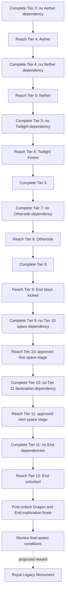

# Dimension progression — D-022 planning authority

> **D-023 — current implementation authority:** The [master directive](sources/MASTER_IMPLEMENTATION_DIRECTIVE_2026-10-31.md) authorizes incremental coding and supersedes the D-021/D-022 review-only hold. New-world Town Hall / existing-world Lodge profiles, owner Hut bootstrap, blueprint-market acquisition, automatic server-valid placement, supports up to four blocks, Tier 3 Bank (no new-world Storehouse), updated profession/economy/quest/admin scope apply. End remains Tier 12. The [full replacement mod snapshot](sources/MOD_SNAPSHOT_2026-10-31.txt) now reports FTB Quests installed. See [supersession and actual status](MASTER_SUPERSESSION_MATRIX.md); old descriptions below are historical where they conflict.

**Confirmed design, 31 October 2026 (Asia/Riyadh); documentation only.** End access moves from Tier 9 to **Tier 12**. All earlier End-at-9 designs are superseded. No Java, executable datapack, recipe, configuration, world or JAR is changed by this decision. The current 0.4.0-dev binary still enforces its old Nether-5/End-9 rules; it does **not** implement this schedule. Implementation remains on hold pending revised progression review and the D-021 blueprint/migration review.

## Confirmed target schedule

| Reached kingdom tier | Dimension/progression becomes available | Remaining verification or review |
| --- | --- | --- |
| 1–3 | Existing Overworld settlement | No newly scheduled dimension access |
| 4 | The Aether | Pin an actual compatible NeoForge 1.21.1 release/dependencies, registered dimension and entry routes |
| 5 | Nether | Existing vanilla gate remains Tier 5; re-test alternate mod routes with the final pack |
| 6 | Twilight Forest | Compatible release, dimension, internal boss/progression requirements and entry/return rules |
| 8 | Deeper and Darker / The Otherside | Compatible release, actual dimension key and portal/teleport requirements |
| 10–11 | Ad Astra planetary progression | Exact compatible artifact/dependencies, planets/moons and their Tier 10 versus Tier 11 assignments remain unreviewed; do not unlock every destination at Tier 10 by assumption |
| 12 | The End | Dragon combat and End exploration occur **after reaching 12**, as the shared kingdom finale |

Tier 7/9 gain no new dimension from this schedule; their remaining rewards/services are not removed or invented. Dimension labels are not proof of verified mod compatibility or exact registry IDs. Town Hall remains future Tier 2 under D-021. **Royal Legacy Monument** remains the **proposed Tier 12 final construction reward**; dimensions, costs, award policy, blueprint entitlement and NPC/functions for the Monument remain unapproved. It does not move the Town Hall back to Tier 12 or add a Tier 13. Creative Energy Cube still additionally requires the appropriate active Master Mechanic entitlement.

## Mandatory path and finale are separate

A milestone is gathered at its source tier. Requirements to reach Tier 12 include Tier 11 → 12 and **every transitive prerequisite** along the way. None may require End access, an End-only drop, End exploration/dragon credit, or a recipe/service that only becomes possible through the End. Unlock the End because the kingdom has already attained Tier 12; do not make Dragon completion the condition for reaching/unlocking that same tier.

Known End-exclusive material families removed from all pre-12 proposal rows: End stone/bricks, chorus/popped chorus/purpur, shulker shells/boxes, dragon breath and dragon-only/End-city-only outputs, including End rods whose vanilla crafting path needs popped chorus fruit. The list is illustrative, not an exhaustive modpack classifier. Inspect all derivatives, ingredients, machines, research, professions, travel infrastructure and objective evidence as well as direct item requirements.

Ender pearls/eyes are **not inherently End-exclusive**: legitimate Overworld/Nether paths may be available. Do not blanket-ban an `ender` name or assume an item requires End travel. Conversely, a neutral item name or a registered ID does not prove an End-independent acquisition path. Verify the final pack's recipes and approved gates.

At Tier 12, propose a shared Dragon encounter and End expedition/return objective, optionally followed by reviewed End-resource contributions and the Royal Legacy Monument construction award. Exact participation/credit, first kill versus repeat encounter, quantities, winner recognition, approval evidence and materials-included policy need review. The unique dragon egg is not proposed as a mandatory consumed item. No new objective, contribution or reward is activated here.

## Revised dependency graph — design, not updated executable logic

The earlier tiers still begin with First Hearth and the reviewed building path; they are omitted from this dimension-focused diagram. A dimension capability available at Tier n depends on completing milestone n−1. Requiring that capability to complete n−1 creates a cycle. This applies independently to Aether 4, Nether 5, Twilight 6, Otherside 8, each reviewed space stage 10/11 and End 12. In particular, `Tier 11 milestone → End capability → Tier 11 milestone` must be rejected, including indirect crafting/objective paths.

Proposed validator extension after approval: model a material/recipe acquisition graph with AND edges for every required ingredient/machine/research dependency and OR branches for legitimate alternative acquisition routes. Require at least one fully verified, approved path available at the gathering tier. An optional End-based recipe does not create a deadlock if a complete approved non-End alternative actually exists; an unknown route does not count as an alternative. Do not claim the current conservative catalogue validator already discovers arbitrary mod recipes.

## Recipe and Ad Astra audit — open blockers

Observed repository evidence: build.gradle pins NeoForge and tests; no pinned final pack manifest or actual Ad Astra/Aether/Twilight Forest/Deeper and Darker dependency is present, and the inspected development server mods directory is empty. No particular release's recipe closure or cross-mod compatibility has been verified. Accordingly these checks are **BLOCKED / UNVERIFIED**, not passed or proven impossible.

| Audit subject | Check with the exact installed versions/data | Acceptance before making a pre-12 requirement mandatory |
| --- | --- | --- |
| Create / Mekanism candidate parts | Every alloy/circuit/mechanism input, machine, heating/fuel, recipe replacement, machine permission and processing chain | At least one approved End-independent route available by its gathering tier |
| Ars / Iron’s Spells / Occultism | Research/ritual ranks, essence/ink/gem ingredients, boss/loot sources, stabilizers/storage upgrades and indirect dimension dependencies | Complete recipe/loot/research closure; no End-only prerequisite before 12 |
| Mystical Agriculture / Productive Bees | Seed/bee acquisition, breeding, substrate, tiers and catalysts; outputs must not hide an End prerequisite | Verified non-End source and approved profession/automation permissions |
| Ad Astra entry infrastructure | Planet selection, rocket tiers, workbench/assemblers, steel/plates/components, launch/fuel, oxygen/suit and safe return infrastructure | Reach first approved Tier 10 destination without End materials; all prerequisites available before attempting its stage |
| Ad Astra Tier 11 advancement | Subsequent rocket/fuel/planetary metals, machines, catalysts, research and the route to each destination | No need to visit a destination to craft the only vehicle that reaches it; no End-derived component required to reach 12 |
| Modpack patches and alternate recipes | Datapacks, scripts, integrations, shops/loot, research locks, tag expansions and recipe alternatives | Audit actual final server recipe data, not just upstream defaults or item registration |
| Building/profession/community objectives | Blueprint materials, necessary quest rewards/tools and administrative proof required for advancement | No hidden End visit, Master/recipe gate unlocked only by the same or a later milestone |

Prior Occultism tier-3/tier-4 stabilizer candidates are withdrawn from pre-12 rows pending this audit; no claim is made that their selected-version recipes definitely require End items. Other modded candidates remain optional review slots, **not mandatory approved requirements**, until certified. Ad Astra progression is a design intention until compatibility, planet split and recipe closure are verified; do not claim it works on NeoForge 1.21.1 simply because it appears in this schedule.

If an unavoidable End dependency is found: propose an explicitly reviewed supported non-End recipe/source, an earlier-accessible substitute or moving that item/optional branch to the post-12 finale. Never resolve it by opening the End early, granting free quest items, assuming an admin exception, silently editing recipes or enabling a partially verified milestone.

## End access enforcement — future acceptance criteria

The server must deny ordinary entry to `minecraft:the_end` below Tier 12 regardless of vanilla portal, mod portal/teleporter, waystone/anchor, spell, item, machine, vehicle/passenger, saved destination, command-assisted player action or alternate dimension-transfer path. Map actual mod APIs and dimension aliases using the selected pack; enumerate routes that do not use the previously tested NeoForge travel event. A single cancelled event is not proof of universal coverage. Missing supported interception must remain an explicit blocker or a reviewed disablement of the bypass feature; no silent coverage gap.

Validate the current shared tier at transfer commit; invalidate cached authorizations across unlock/state changes and restart. Test arrival/return, group/passenger transfer, direct dimension APIs, packet tampering and stale destinations. The deny message should explain Tier 12 and point to kingdom progress. A decorative locked UI, hidden recipe or portal-only check is insufficient. Do not create an implicit operator bypass; any maintenance exception needs separately specified permission, confirmation and audit.

## World and historical preservation

Do not lower attained tiers, rewrite accepted contribution history/winners, remove existing End blocks/items, reset dimensions/dragon state, delete NPCs/buildings or rerun rewards. Existing 0.4.0-dev worlds may already have legitimate Tier-9 End visits. Keep those records historical; future Tier-12 finale credit for an earlier kill/visit needs explicit review rather than automatic erasure or retroactive completion.

Before rollout, review pre-12 players already inside the End, login/respawn/bed/anchor destinations, last-safe-return data and avoidance of player stranding. Recommended policy for review: deny new entry while preserving safe exits and inventory; separately approve a safe relocation/login strategy for already-inside players. Do not automatically move or confiscate anything in this planning task. Back up and test complete-world copies; source/resource gate changes and data migration are future reviewed work.

## Royal Gilded progression design

Show the confirmed target schedule, especially **Tier 9: End remains locked** and **Tier 12: End unlock**. Mark Aether/Twilight/Otherside/space integrations as planned/unverified until tested. At Tier 12, separate the attained tier/dimension unlock from unfinished Dragon/expedition finale and the proposed Monument award. Display plain prerequisite/blocker explanations, independent building/service gates and historical recognition; no screen may claim mod access or final reward is functioning without server support.

These are future screen requirements. The 0.4.0-dev screen, catalogue JSON, validator profiles and travel code still use their prior End-9 assumptions; they are deliberately not edited here. Update them together with tests/protocol as required **only after review authorizes implementation**. Do not ship a new binary or claim new enforcement/performance/runtime tests from this documentation checkpoint.

## Review-to-implementation acceptance plan

After explicit approval, update `KingdomTravelRules`, the independent capability/material profiles in `MilestoneValidator`, bundled milestone JSON, server projections/client labels and relevant tests consistently; add only verified dimension/mod adapters. Do not update a label alone or change only the JSON while the compiled gate remains 9. Keep the separate D-021 legacy reward/profile migration safeguards.

Test End entry at Tier 11 (deny) and Tier 12 (allow), all earlier tiers (deny), approved return/legacy-inside handling, actual installed alternative teleport routes, two-client transfers and restart. Test Aether 3/4, Nether 4/5, Twilight 5/6, Otherside 7/8 and each approved planetary-stage boundary. Reject direct and indirect End dependencies in Tier 11 → 12 and every earlier mandatory milestone; allow only reviewed post-unlock finale dependencies. Test AND/OR recipe alternatives, cycles and unavailable professions/research. Preserve historical contribution/winner/End/Dragon fixtures. Capture real Royal Gilded locked/unlocked/finale screens and run full builds/native integration checks; none of these new checks is claimed executed now.
