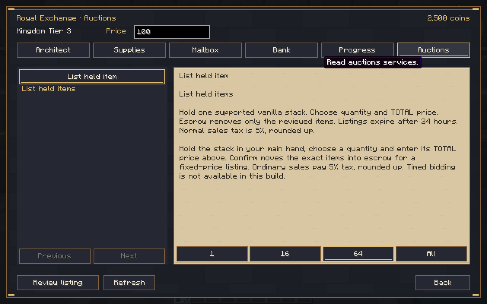
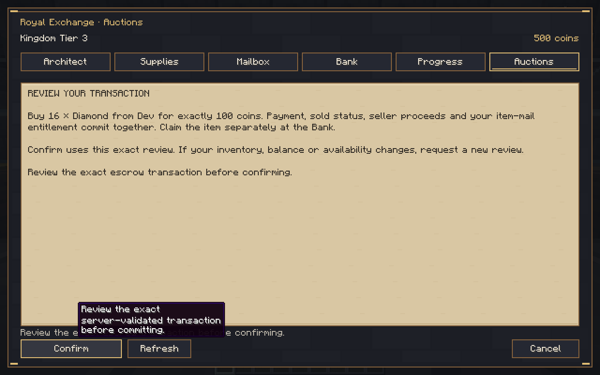
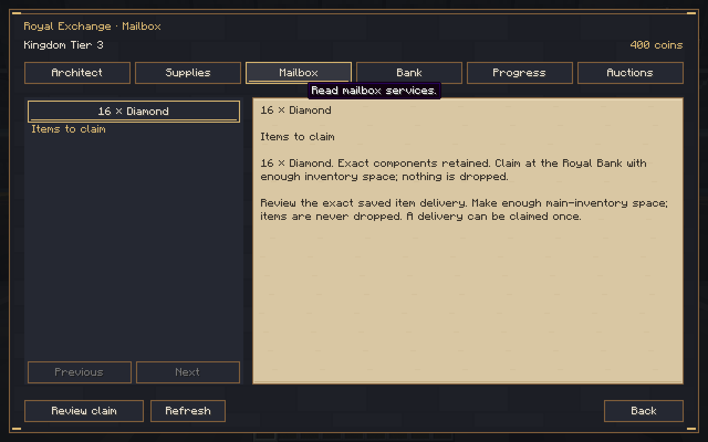
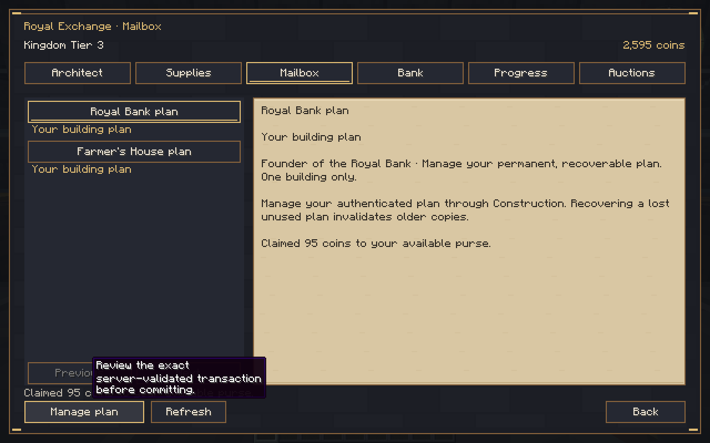
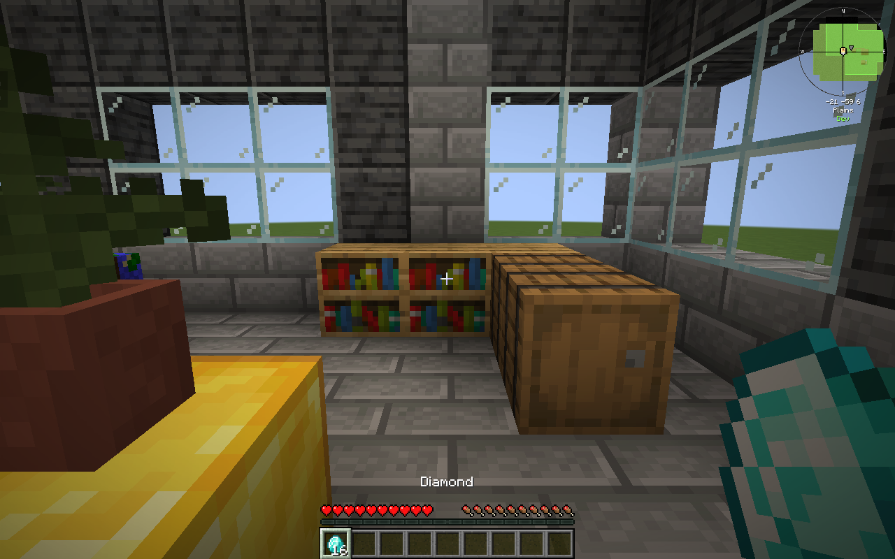
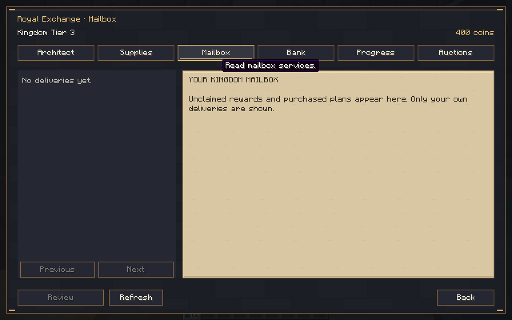
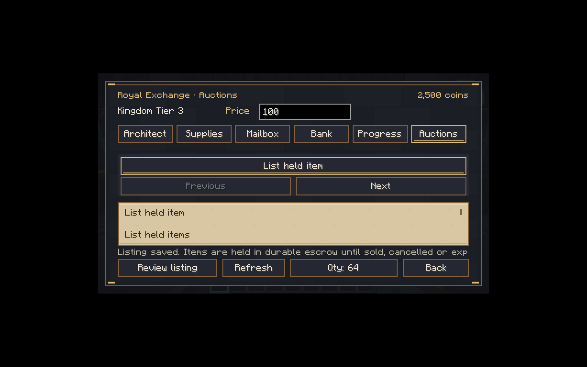

# Royal Gilded 0.8.0-dev — fixed-price auctions and item mail

Source **03e167499a9a4171f4964a027f20ab11af5e1196**, development branch `rebuild/royal-gilded`. Minecraft **1.21.1**, NeoForge **21.1.265**, Java **21**, protocol **9**. **Development build; the complete game and full auction suite are not finished.** Main was not merged.

[Download the JAR](kingdom-smp-core-0.8.0-dev.jar) · [Test evidence and isolated QA save](test-evidence.zip) · [Checksums](SHA256SUMS.txt) · [Actual implementation and limits](../../AUCTION_CHECKPOINT.md) · [Validation](../../VALIDATION.md) · [Completion matrix](../../PRODUCTION_COMPLETION_MATRIX.md).

JAR SHA-256: `3b4584b90e1615712c3f264527eb03ea2b77b27e0bf2f66ffa9402332f0221aa`.

## Install and test

Back up the entire world and matching player data. Replace Kingdom SMP on both client and server; only one version should be installed. Do not downgrade a world containing new escrow operations to0.7; restore a matching backup instead. The original Hut/Hall and0.7marketplace/Bank features remain. The Hut confirmation is clickable and lasts five minutes.

1. Reach Tier3 and complete the physical Royal Bank, using the [0.7flow](../a211428/CHECKPOINT.md).
2. Visit the registered Banker. **Auctions → List held item**: hold one supported vanilla stack, choose quantity and TOTAL asking price, then review/confirm. This removes exact items into durable escrow without a listing fee. If holding an item prevents NPC interaction under OPAC's empty-hand policy, use `/kingdom commerce open` while physically at the Bank; all transactions still recheck the real counter.
3. Another player reviews the listing and purchases once. Its item goes to the buyer's private Mailbox; sale proceeds go to the seller's coin mail. Ordinary tax5%roundsup inside the asking price and **permanently leaves circulation**, per explicit D-029. The10%Master calculation is tested in the store, but Master items are not implemented/accepted in this slice.
4. At the Bank, the buyer reviews/confirms the item claim with adequate main-inventory space; items are never dropped. Seller reviews/confirms proceeds once. A full inventory, foreign mail, stale review or repeated request cannot duplicate delivery.
5. Seller cancellation and24-hour fixed-listing expiry return unsold escrow through item mail. Public auction state and private mail survive restart.
6. Operators can inspect actual escrow via `/kingdom admin auctions inspect`; existing audited economy commands remain. No ordinary player is granted operator permissions.

Public NPC dialogue under claims requires deliberately authorized configuration. Read [optional setup](../../PUBLIC_NPC_CLAIM_SETUP.md) and its example datapack. The mod does not automatically alter your claim settings. Both exact claim mods were loaded in the real-client test; host-authorized empty-hand dialogue did not grant attacks, chest access or block editing. FTB's tag alone lacks an empty-hand check, so full-pack capture-item behavior is not certified.

## Actual results

**207JUnit passed**, zero failures/errors/skips; full Gradle build passed. The connected native auction suite passed on a normal dedicated server with the entire preceding Hut/Hall/Farmer/Tier3/Bank loop, three native auction peers, native item checkpoints, first-buyer contention, precise tax/proceeds, replay/full/foreign/stale/distance guards, exact named/damaged sword return and journal reload. Earlier failure logs are retained as diagnostics, not counted as passing.

Two real graphical clients completed a16-diamond/100-coin sale. Test setup explicitly supplied ordinary diamonds and an audited500-coin buyer purse. A real server restart **before claims** retained all authority hashes: buyer400coins+one16-diamond entitlement; seller2500+95unclaimedproceeds; tax5. Buyer then claimed exactly16diamonds; seller reached2595. A **third server process restart after both claims** retained every authority hash again; the actual buyer client still held16diamonds and its mailbox remained empty, with400coins. Original progression/construction/entitlement records and four residents remained unchanged.

A visitor's original OPAC denial led to the optional public-dialogue setup. After explicit authorization, dialogue worked and its attack still failed; actual Banker health remained20. Normal and854×480rendering were inspected. Pure tests additionally cover IO before/after rename and journal admission/recovery capacity. Native tests accelerate construction by explicit fixture steps; this is functional testing, not a survival-balance or full277-pack certification.

## Actual Minecraft screenshots

Additional captures: [item review](screenshots/item-claim-review.png), [physical delivery](screenshots/physical-delivery.png), [visitor dialogue](screenshots/visitor-bank-dialogue.png), [visitor attack denied](screenshots/visitor-attack-denied.png).

Timed bidding/5%increments/anti-sniping, funded buyorders/partialfills, dynamic NPCshops/contracts, professions/288quests, later buildings/tiers, FTBcampaign and other integrations remain incomplete. Supported item escrow is bounded vanilla noncontainer stacks only. The complete277-entry pack remains unverified. Read the completion matrix; this checkpoint is not1.0.0.

The evidence world belongs to test accounts and is not a production-world template. No third-party mod binaries are redistributed.
