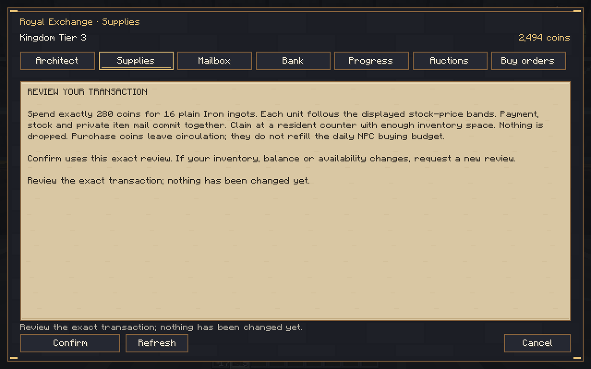
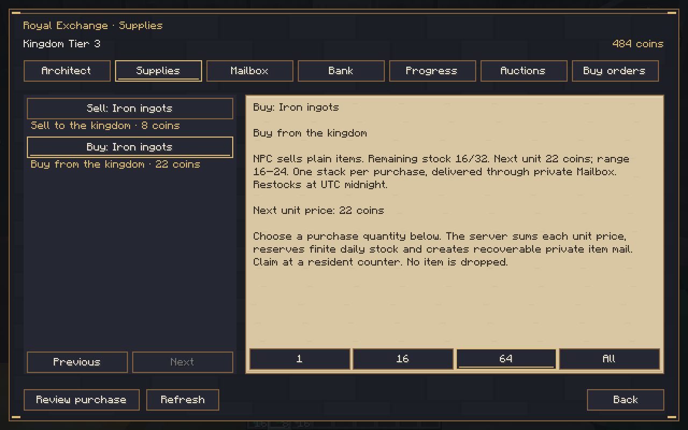
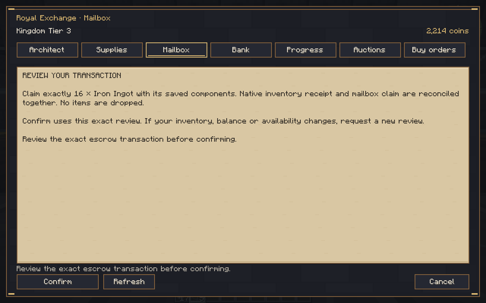
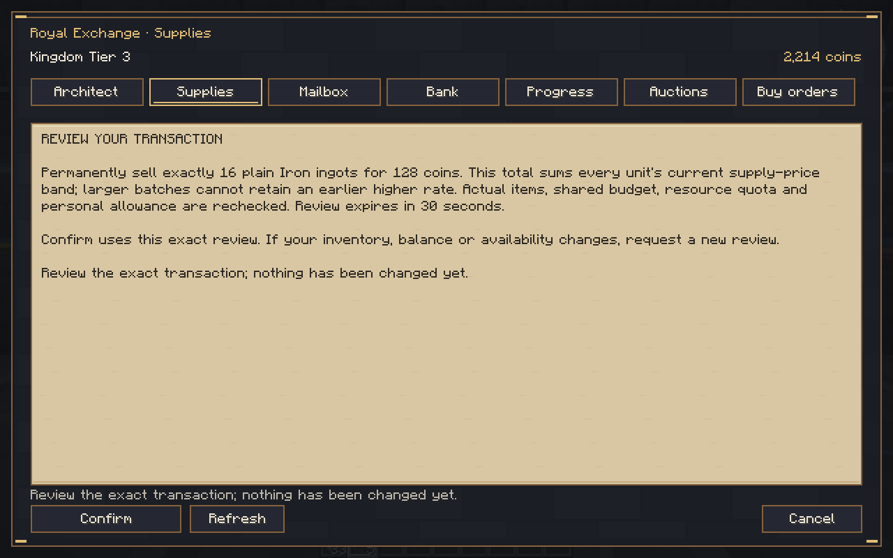
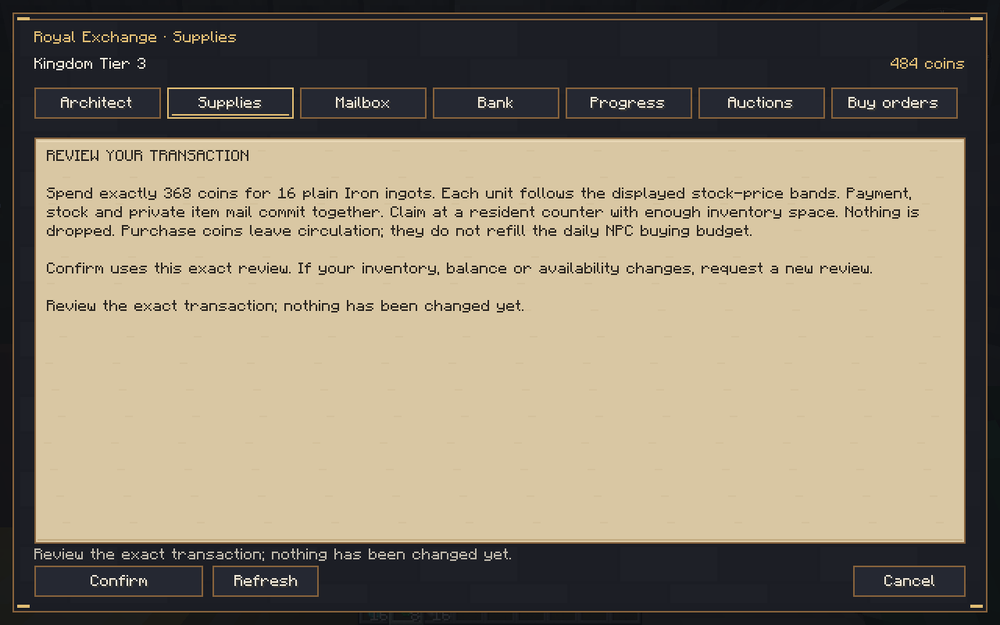
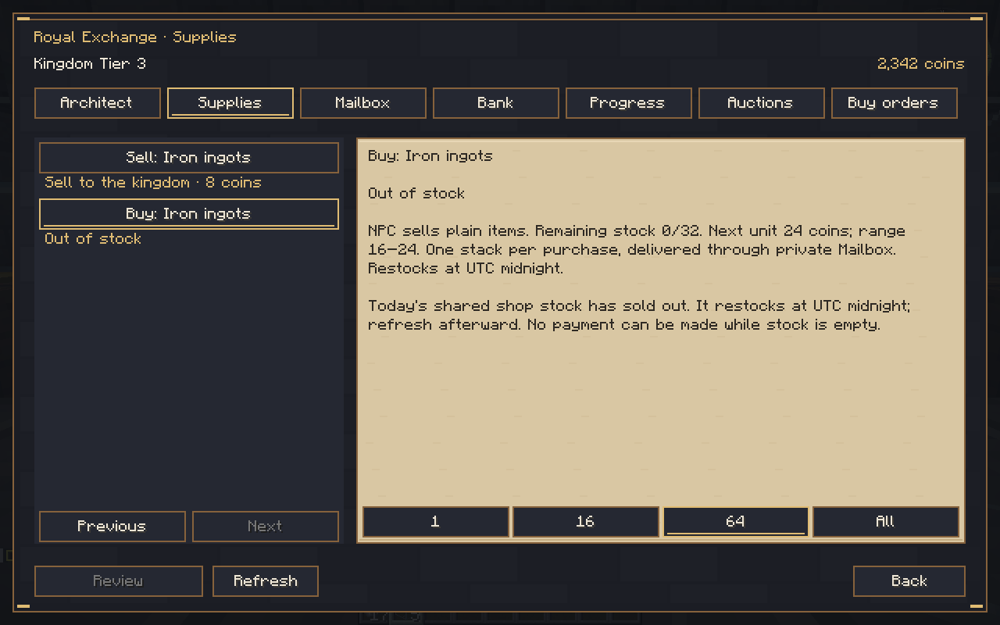
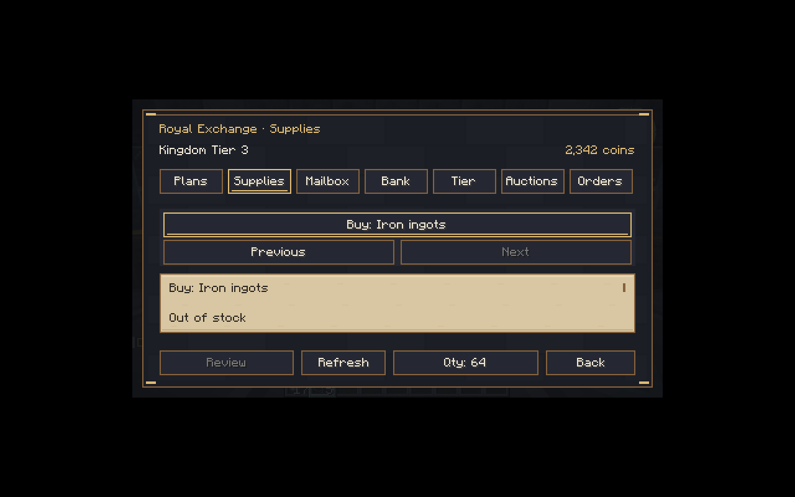
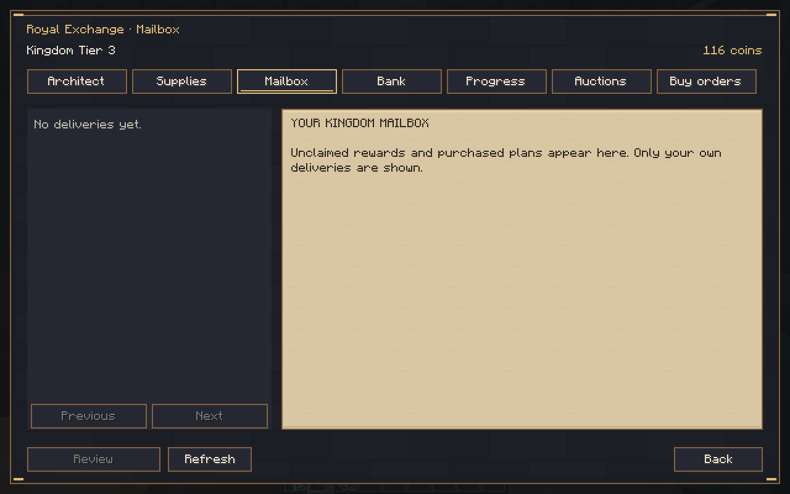
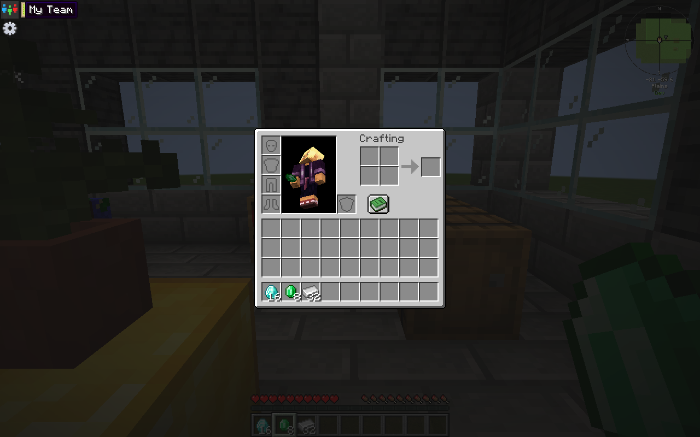

# Royal Gilded 0.11.0-dev — dynamic NPC resource market

Source **04b2e7df4740afca978abeb93c7f662f67bc3467**, branch `rebuild/royal-gilded`. Minecraft **1.21.1**, NeoForge **21.1.265**, **Java21**, protocol **12**. **Development checkpoint; full1.0remains unfinished.** Main was not merged.

[Download the JAR](kingdom-smp-core-0.11.0-dev.jar) · [Actual screenshots, logs and QA save](test-evidence.zip) · [Checksums](SHA256SUMS.txt) · [Implementation/defaults/limits](../../NPC_MARKET_CHECKPOINT.md) · [Validation](../../VALIDATION.md) · [Completion matrix](../../PRODUCTION_COMPLETION_MATRIX.md).

JAR SHA-256: `56f505ef8af9d4916e5b5ca7cd95d8cdb8555c694b22ae757e24baf725e3c23d`.

## Install and test

Back up the whole world and matching player data. Replace Kingdom SMP on server and all clients with this matching version. New shop-operation saves require this version or newer; restore a matching backup to downgrade. Earlier Hut/clickable five-minute confirmation, Hall, contributions, marketplace, coins, Bank and all three auction modes remain.

At a completed Tier2resident counter, open **Supplies**. Select **Sell:** to earn coins from exact plain inventory items, or **Buy:** to purchase limited shared NPC stock. Choose quantity, review the exact total and confirm. NPC buying prices fall as the daily resource quota fills; NPC selling prices rise as stock is consumed. Every unit is summed across bands, so splitting/combining cannot improve its result. Existing budget/quota/personal allowance still bind. Newly bought items go to private **Mailbox**, claimable at a real resident counter with enough inventory space. Nothing is dropped. Actual auction/order/return mail remains Tier3Bank-gated based on its canonical origin, not its name.

Four original plain vanilla resources only. Default NPC buy/sell ranges and daily sell stock: oak1–2/4–6/256; cobble1/2–3/512; wheat1/2–3/256; iron4–8/16–24/32. These are configurable defaults under D-032. `serverconfig/kingdomsmp-market.json` inside the world loads on restart; invalid/arbitrage-unsafe spreads refuse. Selling floors must exceed maximum NPC buying prices. UTC midnight derives new quota/budget/stock counters without erasing history; same-day restarts do not restock. NPC purchase coins leave circulation rather than refilling the buying budget. Auction5%/10%tax sink is unchanged; profession bonuses/contracts are not implemented here.

`/kingdom admin market inspect` reads actual daily counters, prices/stock, budget and cumulative NPC purchase coin sink under administrator permission. No new manual restock/repair, player-facing Economy Ledger or direct trade feature is claimed.

## Executed verification

**273JUnit passed**, zero failures/errors/skips, full Gradle build successful.31new tests cover marginal pricing/split invariance, bounded quotes, final-stock contention, replay, independent days/resources, native pre/post receipt claims, historical identity and pre/post-rename IO recovery. Full normal-dedicated preceding Hut/Hall/Farmer/Tier3/Bank/fixed/timed/buy-order suite passed (3m21s). New dedicated market suite passed (4m3s), including actual Tier2 shop/mail,32stock, no NPC arbitrage, stale/moved/full-inventory refusal, receipt reload and an actual auction mail with an NPC-looking name remaining BankTier3gated.

Two actual graphical clients bought32iron: first16cost280, final16cost368. A normal server restart before the first claim preserved all authority hashes, debit, remaining stock, inventories, receipt chains and NPC identities. The buyer claimed16once, then sold16for128: a152coin loss on the280purchase. The second buyer claimed16once, ending with32iron including its old16. Stock stopped at0/32with explicit Out of stock wording. Subsequent server/client restart/rejoins and the final clean saves retained items, spent stock and consumed mail. Actual1280×800and854×480window UI was inspected.

Final purses2342and116; NPC purchases removed648, new sale minted128, prior auction tax22unchanged. `2342 + 116 + 22 + 648 − 128 = 3000` original auction funds. Devretains17iron/5glass; DevTwo retains16diamonds/8emeralds/32iron. The entire35-operation0.10history prefix, all non-economy kingdom authorities and four NPC identities remain unchanged. No live test funding/item grants or clock changes were needed.

## Actual Minecraft screenshots

## Remaining limitations

One native stress run placed all600Farmer blocks but lost14of15crop cells before handover, paused under strict prefix validation, and timed out without another resident/reward. A fresh run completed; **the environmental cause and authorized repair policy remain unresolved**. No crops regenerate and production construction validation was not weakened. The native stair geometry fixture now starts grounded on verified supported home; production navigation unchanged. Initial missing test template was added; the runner now fails/stops No tests found rather than accepting a Gradle exit alone. Failed logs are clearly distinguished from passes.

Profession bonuses/contracts/reward pools, remaining buildings, profession gameplay/288quests/Master equipment, later tiers/integrations/FTB/admin/full277pack acceptance remain unfinished. The coarse economy count stays4/5because the contracts/bonuses slice is missing. Future bonuses must preserve the anti-arbitrage spread at their effective buying ceiling. No new copied-legacy campaign was replayed in this slice. This QA save is evidence, not a production template; third-party binaries are not redistributed.

Continuation: resume this branch/source and read CODEX_CONTINUATION. Investigate the construction crop-loss limitation and implement the next approved profession/contract dependency without inventing unapproved quest filler or replacing existing authority stores. Never merge main or label partialdevelopment1.0.
