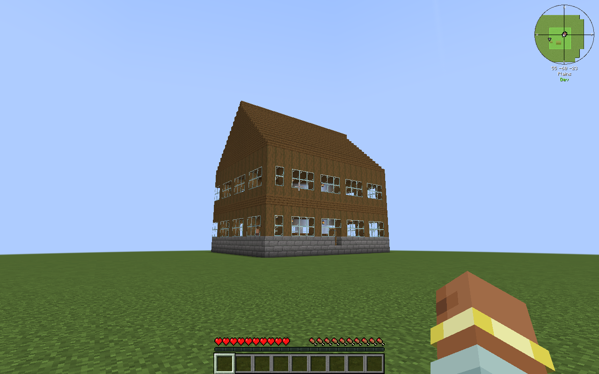
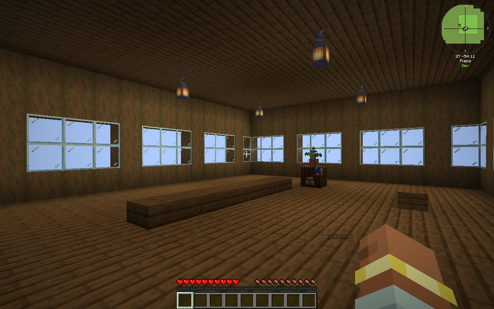
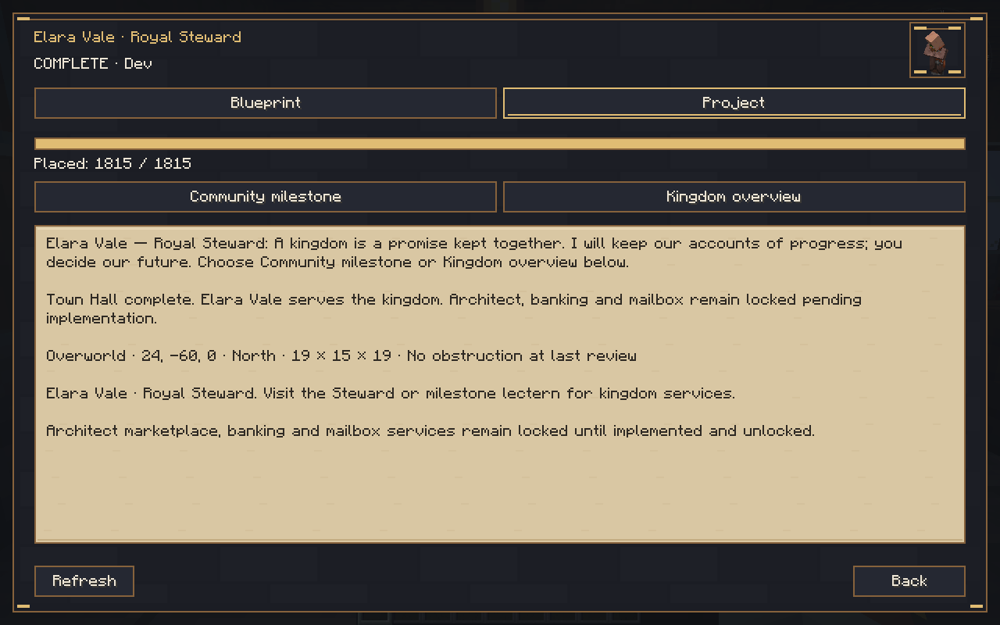
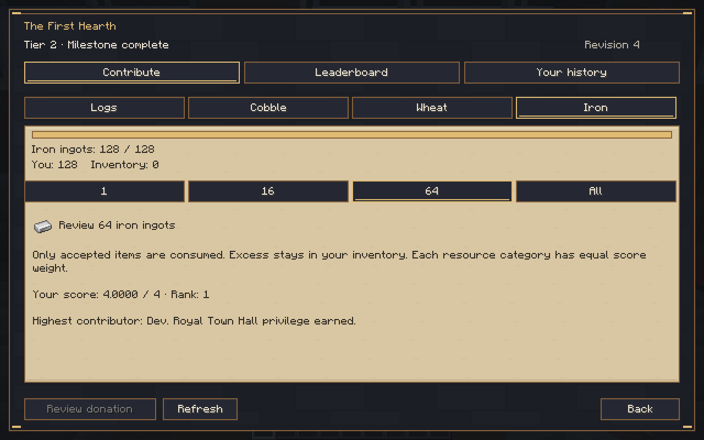
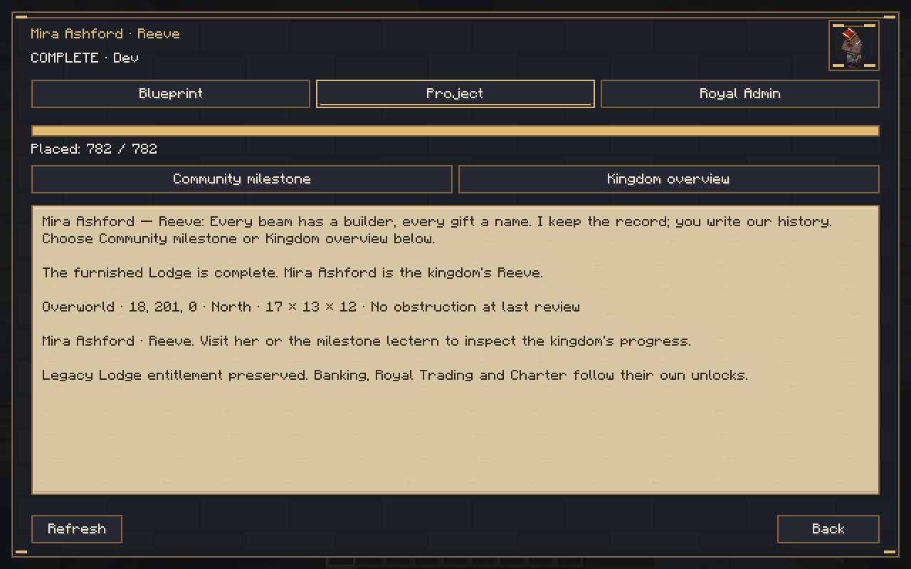

# Royal Gilded 0.6.0 — playable fresh-world Town Hall

Source: **25aa1dc27566f255086de0395202c42a22c415be**, based on `9fb65ec`, development branch `rebuild/royal-gilded`. Minecraft **1.21.1**, NeoForge **21.1.265**, Java **21**, network protocol **7**. This is an installable development milestone, not the complete 1.0 release. Main was not merged.

[Download the development JAR](kingdom-smp-core-0.6.0-dev.jar) · [Test evidence and isolated QA save](test-evidence.zip) · [SHA-256 checksums](SHA256SUMS.txt) · [Current completion matrix](../../PRODUCTION_COMPLETION_MATRIX.md) · [Detailed validation](../../VALIDATION.md) · [Implementation details](../../TOWN_HALL_CHECKPOINT.md).

## What works

Fresh-world profile → free authenticated owner Hut plan → original Hut and single Aldric → reviewed inventory contributions/leaderboard → Tier 2 → winning contributor's unique Town Hall plan → full hologram/rotation/site review → physical saved Aldric construction → verified furnished two-floor 19×15 Hall → permanent Elara Vale and live kingdom/First Hearth services. Current complete-terrain-support and both verified claim checks remain. Existing worlds pin a legacy profile and retain their original Lodge, Mira, contributions, rewards and construction records.

## Install and test

Back up the **entire** world. Replace the previous Kingdom SMP JAR on both client and server; do not install two versions. Use the matching Minecraft/NeoForge/Java versions above. Optional claims integrations were tested with FTB Chunks2101.1.22, FTB Library2101.1.39, FTB Teams2101.1.11, Architectury13.0.11 and OPAC0.33.0 together. The full277-mod pack is not certified.

1. Create a fresh world. Integrated play pins its actual owner. On a dedicated server, the host reviews `/kingdom admin owner <online-player>` then repeats with `confirm`; level4 is required and ownership cannot be reassigned.
2. The owner opens **K → Construction → Claim blueprint**, confirms the claim, holds the Hut plan, aims at a supported clear site, and uses it. Review/confirm the site, then in Project review/confirm construction. The approved instant starting-Hut exception introduces one Aldric.
3. Open Community milestone/Contribute and review actual inventory donations: **1,024 logs, 2,048 cobblestone, 512 wheat, 128 iron**. Partial donations work. Completion consumes accepted items, reaches Tier2 and permanently records the normalized highest contributor.
4. The winner claims the Hall plan through Construction. Aim with it; **R/Shift-R** rotates and **Page Up/Down** adjusts height (remappable). The full building stays at the last ground site while looking up to inspect the roof. Green requires matching server validation. Use the plan, confirm the exact site, then review/confirm construction in Project. The server authorizes valid fresh-profile placement automatically; legacy administrative review is preserved.
5. Keep Aldric's walkable route/work post and site chunks available. He constructs progressively; no permanent chunk tickets or terrain destruction. The production cadence is one block per ten ticks. Restart during construction and inspect the same project.
6. At **1,815/1,815** verified blocks, interact with **Elara Vale, Royal Steward**, or the side milestone lectern. Kingdom overview, contribution counter/history/leaderboard and milestone information are real. Walk the rear staircase to the furnished upper gallery. Architect marketplace, banking and mailbox remain visibly locked pending implementation.
7. Restart again. `/kingdom admin inspect` reports the actual profile/owner/journals; `/kingdom admin construction inspect <project-UUID>` verifies loaded prefix and resident identity. Test upgrades on a **copy** of an old Lodge world first.

## Executed acceptance

Full Gradle build passed; **146 JUnit tests**, zero failures/errors. Core native legacy lifecycle, pinned two-claim regression, and the final new-profile native suite passed. Native test peers covered different owner and winner accounts, actual inventory consumption, authenticated plans, durable records, physical furnishing support, staircase pathfinding, service lectern and exactly one named Steward.

The actual non-op Minecraft client completed the clean dedicated-world sequence above, including rotation, both real claim systems, a partial-construction server restart at28 blocks, walking to the upper floor, Steward/lectern services and another **full client/server restart after completion**. Fresh-world kingdom-file hashes and resident identity lists were unchanged after that final restart/service inspection. QA supplied ordinary materials via host give commands and later used isolated vanilla `tick rate100` to shorten construction, restoring20 before handover inspection; no force-tier or force-reward commands were used. Production cadence/persistence were not relaxed.

The real client also loaded a separate copied legacy Lodge save, interacted with Mira and saved/quitted. **All eight original kingdom files remained byte-for-byte identical**, and the same single Aldric/Mira UUIDs remained with no Steward or extra reward. The original save was not opened or modified.

Client testing discovered and corrected stair headroom and a service-lectern anchor. One high-batch native run hit an observed60-second disk-flush watchdog stall during concurrent Minecraft startups; it was not counted as passing. The bounded two-step test rerun passed. Logs retain both outcomes.

No full-pack, two simultaneous real clients, irregular foundation, integrated fresh-owner client, third-party recipe closure or long-term balance certification. Missing issued NPCs require inspection rather than automatic duplicate spawning. Future milestone costs remain inactive. **Next priority: Royal Architect first-buyer marketplace and early economy**, beginning with durable reviewed payment/stock recovery.

## Actual Minecraft screenshots

Final corrected world:

Additional captures: [final Hall preview](screenshots/authenticated-hall-preview.png), [Tier2 earned](screenshots/tier2-earned.png), [resumed construction](screenshots/resumed-progress.png), [verified complete](screenshots/verified-complete.png), [leaderboard](screenshots/leaderboard.png), [lectern](screenshots/lectern-services-after-restart.png), [legacy inspection](screenshots/legacy-inspection.png), [starting Hut preview](screenshots/starting-hut-preview.png). The [earlier full-roof hologram inspection](screenshots/earlier-pass-full-roof-preview.png) is from the initial client pass before the internal stair-clearance correction; final geometry/evidence is the1,815-block world above. All are real Minecraft captures, not mockups.

The evidence ZIP includes successful and failed execution logs, unit result XMLs, immutable comparison reports, the saved isolated fresh QA world and legacy kingdom-data copies. The included QA save is owned by test player Dev and is evidence, not a production-world template. Do not replace your real world with it.
