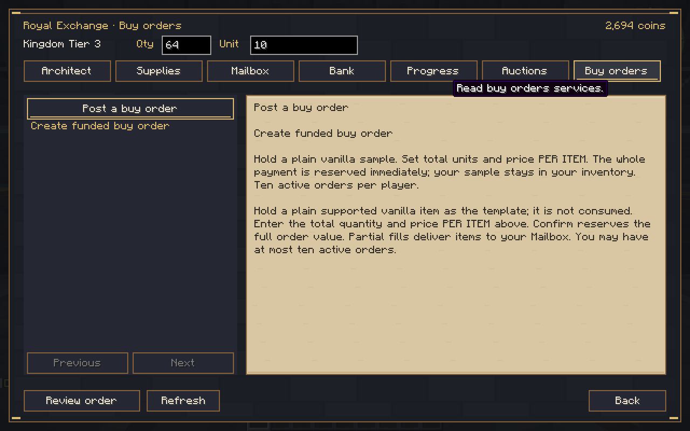
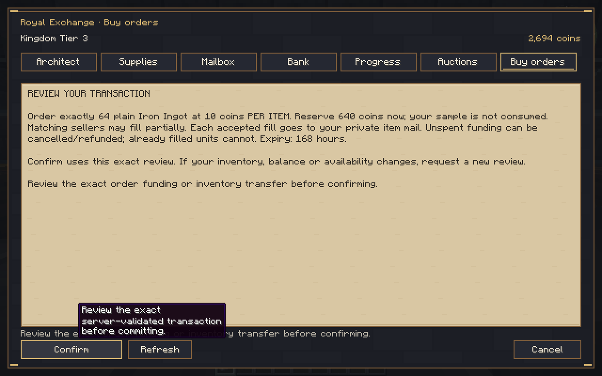
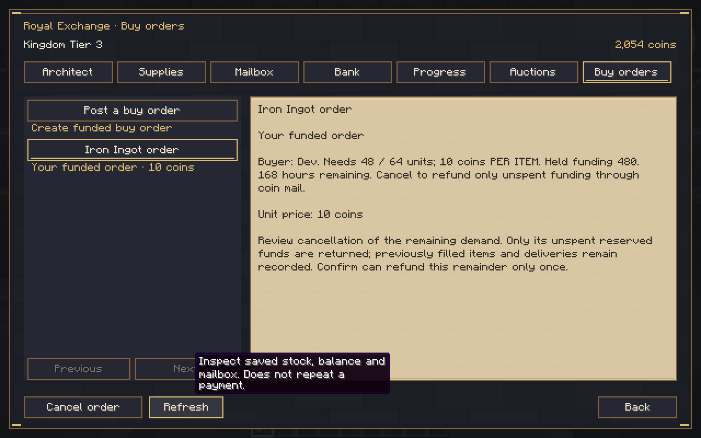
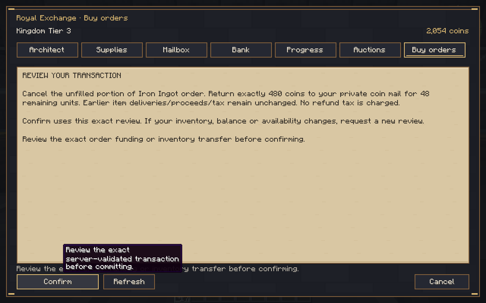
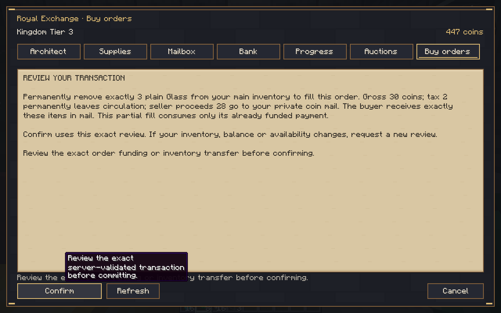
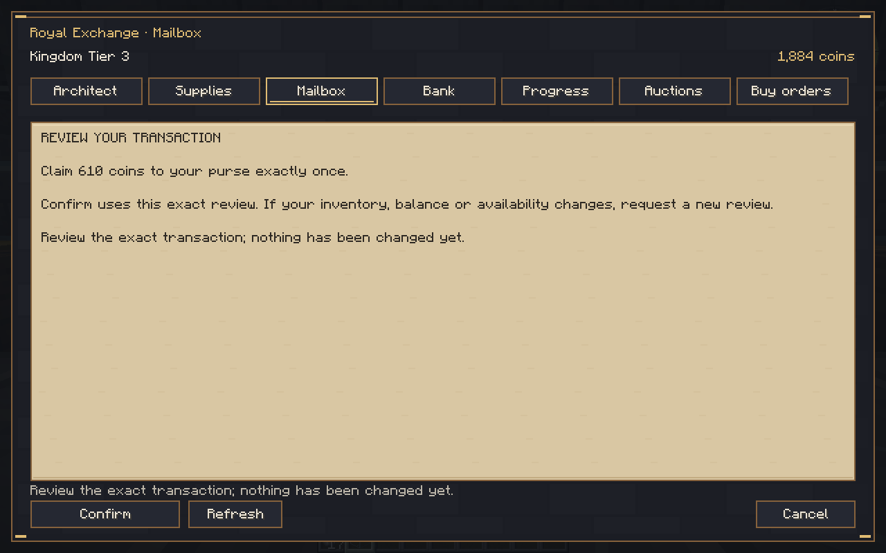
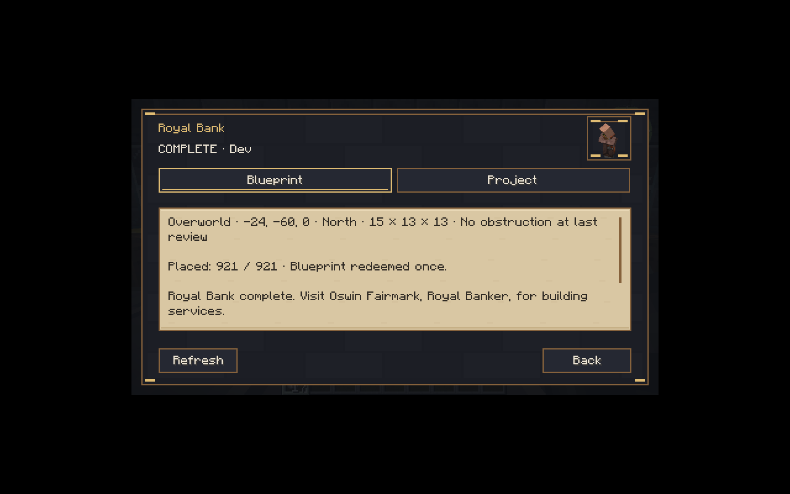
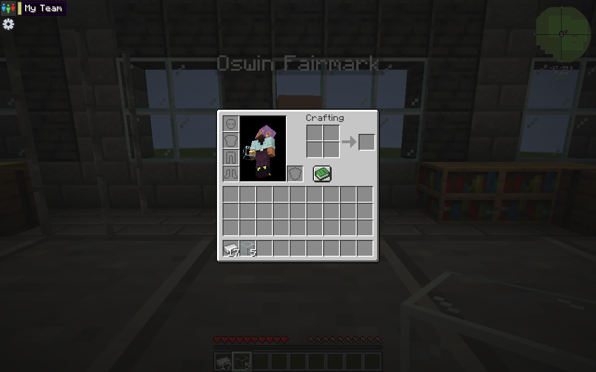
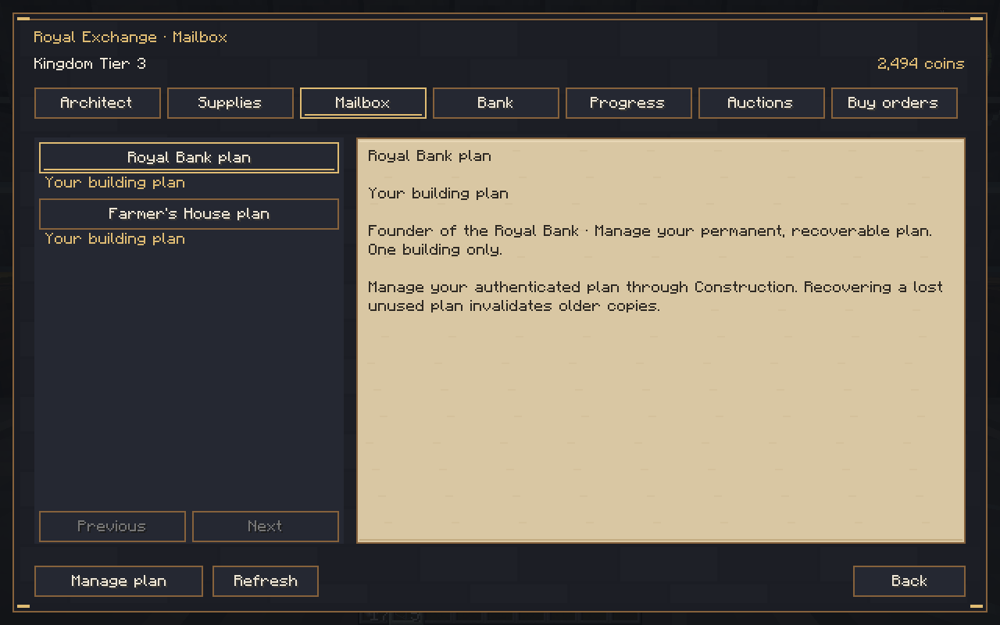
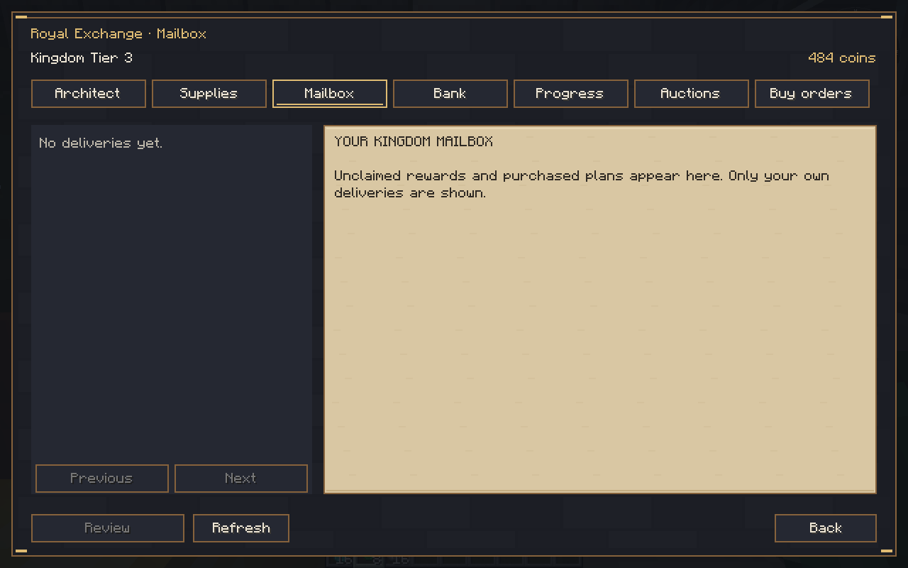

# Royal Gilded 0.10.0-dev — funded buy orders

Source **5899210335df291c2ef83a7ec61bfe0d6385100f**, branch `rebuild/royal-gilded`. Minecraft **1.21.1**, NeoForge **21.1.265**, **Java 21**, protocol **11**. Development checkpoint; the full 1.0.0 game remains unfinished. Main was not merged.

[Download the JAR](kingdom-smp-core-0.10.0-dev.jar) · [Actual screenshots, logs and QA save](test-evidence.zip) · [Checksums](SHA256SUMS.txt) · [Implementation/limits](../../BUY_ORDER_CHECKPOINT.md) · [Validation](../../VALIDATION.md) · [Completion matrix](../../PRODUCTION_COMPLETION_MATRIX.md).

JAR SHA-256: `2dcca955a6d759ad197669a1a24e13b926941b8baee040391e3e584fbad11360`.

## Install and test

Back up your entire world and matching player data. Replace Kingdom SMP on both server and clients with this matching version. New journal operations require this version or newer: do not downgrade an order-bearing save without restoring its matching backup. Existing Hut/Hall, clickable five-minute Hut confirmation, contributions, marketplace, coins, mail, Bank and fixed/timed auctions remain.

At the completed Tier 3 Royal Bank, open **Buy orders**. Hold a plain supported vanilla sample, set total quantity and price **per item**, review and confirm. The full amount is reserved; your sample stays. Another player selects the order, chooses a fill quantity, reviews exact items/tax/proceeds and confirms. Only accepted matching items leave inventory. Claim buyer items and seller coins through private Mailbox. The owner may review cancellation to recover only the unfilled funding. Expiry refunds the same remainder automatically. Neither path refunds already purchased items or taxes.

Maximum ten active/player and100kingdom-wide. Quantity1–2304, unitprice1–1billion within actual purse funds; fills at most one actual stack. Default expiry168hours, configurable1–720in world `serverconfig/kingdomsmp-buy-orders.json`, restarted to reload and pinned per existing order. Plain default vanilla noncontainer templates only: customized/modded/ownership items refuse. Manual selected fills; display priority price descending, time thenUUID. Ordinary5%/Master calculation10% tax permanently leaves circulation, rounded up per fill; live Master equipment remains unimplemented.

Operators use `/kingdom admin orders inspect`. An isolated copied QA world may explicitly create `serverconfig/kingdomsmp-sandbox.enabled` and level4 `/kingdom admin orders expire-test <UUID> confirm <reason>` to test only that saved deadline, with canonical actor/reason. Normal users need no UUID. Missing marker and ordinary permissions refuse. The published QA save has no marker. Optional public NPC claim setup remains opt-in; construction permissions are preserved.

## Executed verification

**242JUnit tests passed**, zero failures/errors/skips; full Gradle build passed. Full normal-dedicated prior Hut/Hall/Farmer/Tier3/Bank/fixed/timed/buy-order suite passed with both pinned claim APIs, real native inventory receipts, concurrency/stale-review refusal, partial fills, exact mail, refunds, reload, guarded command permissions and101menu entries at100active orders. Unit tests include interrupted native/IO checkpoints and conservation. These native peers are separate from the two actual graphical clients.

Real clients reserved640for64iron, accepted16items, paid152proceeds/8tax and recovered480unspent coins. A full server and both client process restart preserved the partially filled order, every authority hash, inventory/receipt and four NPC identities. Restarted clients claimed correctly. Glass testing fully filled one unit, then accepted only3available blocks against a64-unit request, and returned610unspent coins on explicit isolated deadline acceleration. Per-fill tax rounding produced37glassproceeds/3tax. This is not a claim of seven elapsed days.

Final buyer2494 +seller484 +permanently removed tax22 =3000original auction funds. Buyer holds17iron and5glass including its samples; seller retains16iron plus its previous16diamonds/8emeralds. The original history prefix, all non-economy kingdom authorities and four named NPC identities remained unchanged. A final normal server restart and actual two-client rejoin retained items/balances and consumed mail; the final clean stop retained every comparison. No pending operation/quarantine or sandbox marker remains.

Actual1280×800and854×480window rendering was inspected. Completed/reserved Blueprint details now use the full scrollable body at narrow scale; no placement/security logic changed. One diagnostic server wrapper exit143 reflects a deliberate SIGTERM after closed stdin, with Minecraft saves; final builds and normal stops passed. Exact logs and proof JSON are included.

## Actual Minecraft captures

Next: **dynamic NPC prices/shops/contracts**, then remaining approved buildings, professions/288quests/Master equipment, tiers/borders/integrations/FTB/admin and full-pack acceptance. Supported vanilla auction modes are verified, not unrestricted modded escrow or full economy balance. See the completion matrix. This QA save is evidence, not a production template; no third-party binaries are redistributed.
