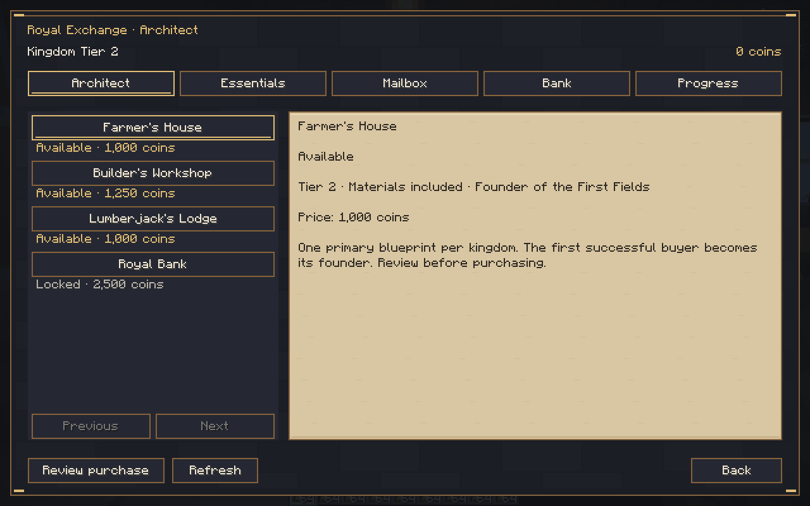
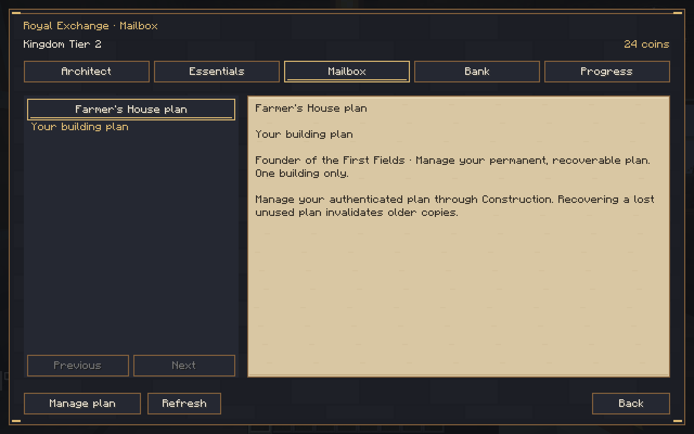
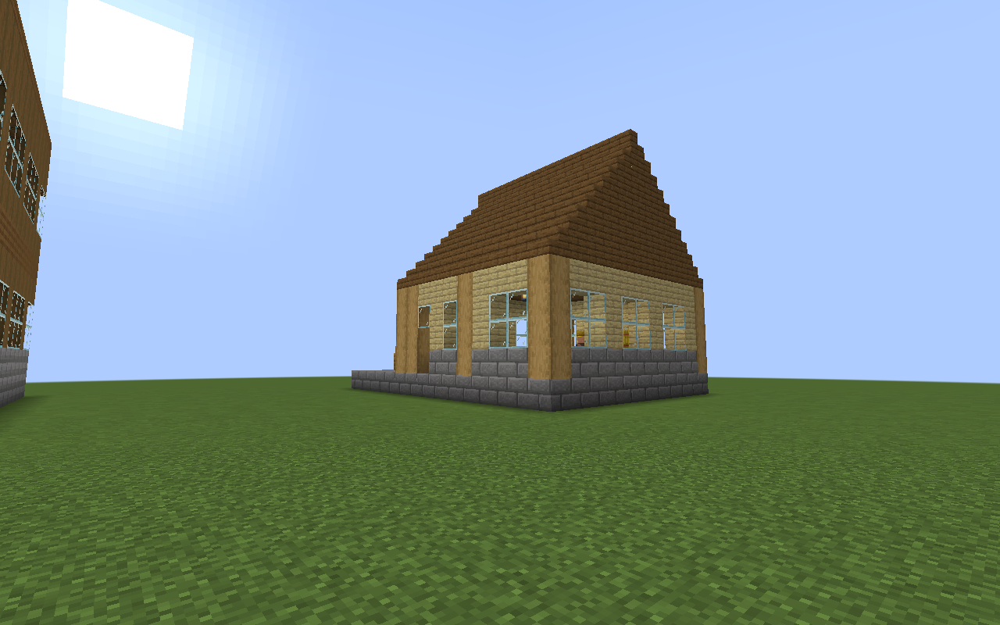
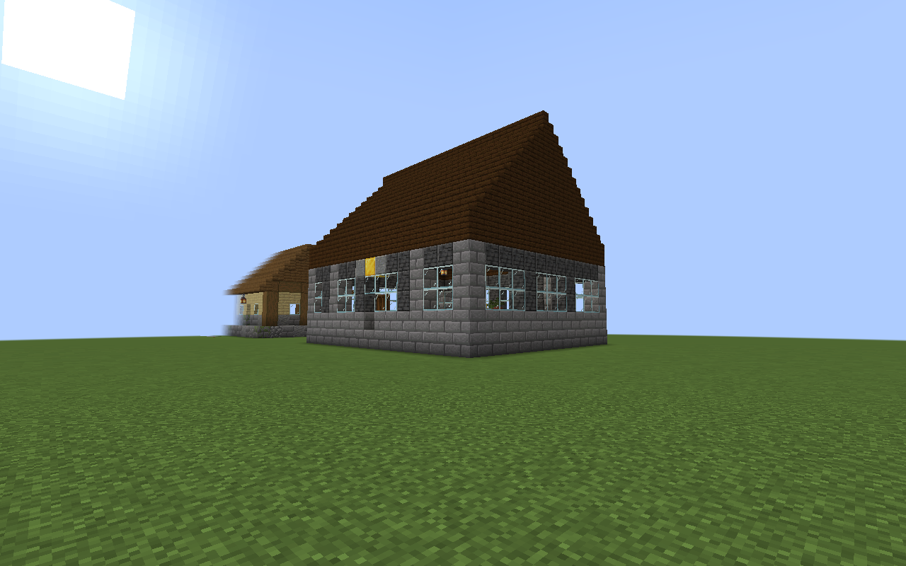
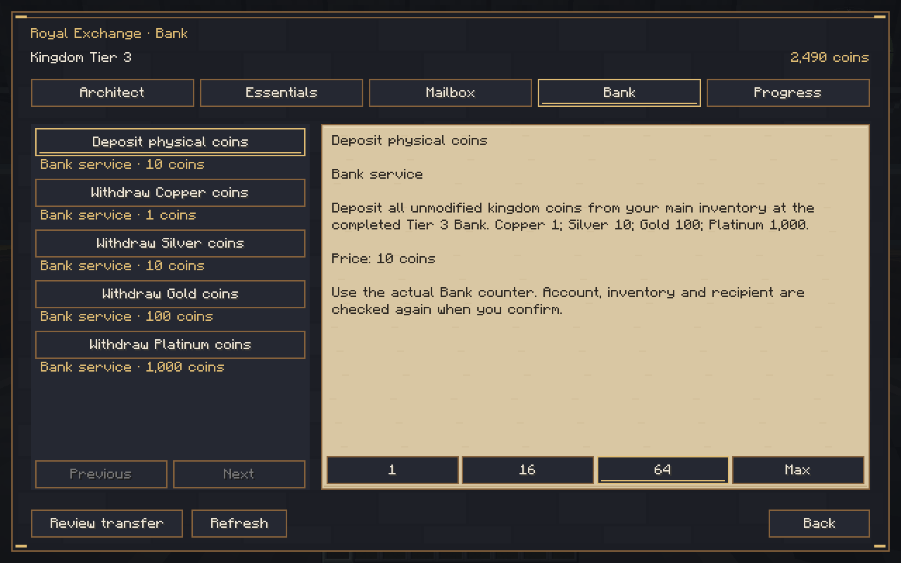
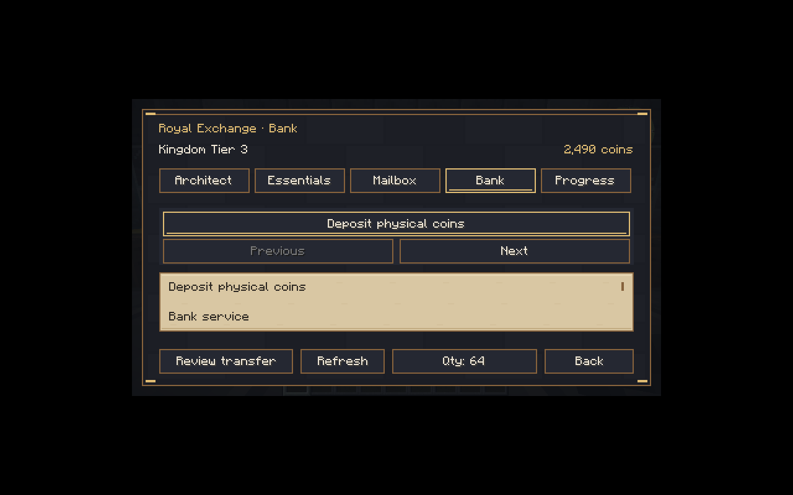
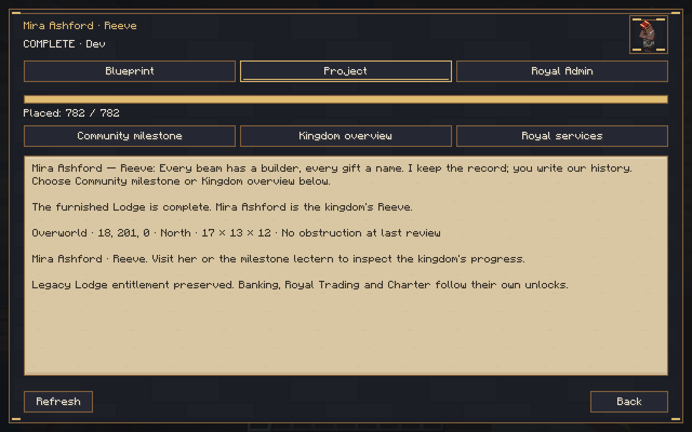

# Royal Gilded 0.7.0-dev — Architect, Tier 3 and Royal Bank

Source **a211428f125409f1c3843299ca104b3d6c4ba918**, development branch `rebuild/royal-gilded`. Minecraft **1.21.1**, NeoForge **21.1.265**, **Java 21**, network protocol **8**. This is an installable development build, **not the complete 1.0.0 release**. Main was not merged.

[Download the JAR](kingdom-smp-core-0.7.0-dev.jar) · [Evidence and isolated QA save](test-evidence.zip) · [SHA-256 checksums](SHA256SUMS.txt) · [Validation](../../VALIDATION.md) · [Implementation/limits](../../COMMERCE_CHECKPOINT.md) · [Completion matrix](../../PRODUCTION_COMPLETION_MATRIX.md).

JAR SHA-256: `d1ee7e977514affb790b451945f9bf38a908cc470f5723fadd6138f2536a5069`.

## Install and play

Back up the **entire** world. Replace the old Kingdom SMP JAR on both server and client; install only one version. Preserve all world data and matching player backups. The exact tested optional claim set is FTB Chunks 2101.1.22, FTB Library 2101.1.39, FTB Teams 2101.1.11, Architectury 13.0.11 and OPAC 0.33.0. This does not certify the full 277-entry pack.

1. The original fresh-world Hut → Tier 1 → winner Town Hall → Elara loop remains. The Hut confirmation still has a five-minute timeout and clickable chat command. See the [previous checkpoint](../25aa1dc/CHECKPOINT.md) for that sequence.
2. At Tier 2, visit Elara and choose **Royal services**. Essentials buys plain oak logs, cobblestone, wheat and iron ingots within real daily quotas/budgets. Choose a quantity, review exactly what will be consumed and confirm. `/kingdom commerce balance` reads your purse remotely; transactions require an actual nearby service counter.
3. Architect offers one Farmer, Builder and Lumberjack primary plan per kingdom. Defaults cost 1,000 / 1,250 / 1,000 coins. The first successful buyer pays once and receives permanent founder recognition and a private plan entitlement; others see sold out.
4. Open **Mailbox → selected plan → Manage plan**, claim it through Construction, hold it and use the existing full hologram, rotation/height controls, server validation and review/confirm flow. Purchased materials are included. Aldric constructs progressively; keep his route and required chunks available. Both claim systems must authorize the actual owner at every step; under those mods, owner logout pauses work. Lost unused plans are recovered from the same entitlement, never a second reward.
5. On a fresh Town Hall profile, **Progress** accepts partial Tier 2 contributions: 2,048 logs, 3,072 cobblestone, 768 wheat, 192 iron, 384 copper, 256 glass, 384 bricks and 64 leather. Completed Hut/Hall and a host-inspected connecting road are required. The host reviews `/kingdom admin milestone road`, then appends `confirm <reason>` after inspection. Completion reaches Tier 3 and records the top contributor without an extra building grant. Values are new documented configurable defaults, not a claim of historical balance approval. Legacy Lodge profiles do not activate these new costs.
6. At Tier 3, buy the Royal Bank plan (default 2,500), place/build it normally, then visit its permanent named Banker. Use Bank to review/confirm four physical denominations, deposits and nearby-player account transfers. Account inspection remains remote; conversions/transfers require the actual intact Bank and valid counter/range/line of sight. Full inventory, nonempty cursor, stale reviews and malformed/replayed requests refuse safely.
7. Restart during construction and again with physical coins held. Inspect actual state using `/kingdom admin economy inspect <online-player>`, `/kingdom admin milestone inspect`, `/kingdom admin inspect` and existing construction inspection. Level-4 test funding uses reviewed/audited `/kingdom admin economy set <player> <coins> confirm <reason>`.

Config files live in the world's `serverconfig/kingdomsmp-commerce.json` and `kingdomsmp-tier-two.json`. Active milestone costs are pinned to their history; do not reinterpret existing donations by editing them. The physical coin models currently reuse vanilla source textures. General item mail, auctions, dynamic prices, profession gameplay, later buildings/tiers, four-block foundations, full FTB campaign and mod integrations remain unfinished.

## Actual executed checks

**186 JUnit tests passed** with zero failures/errors/skips; full Gradle build passed. Existing core, normal-dedicated pinned claims, connected commerce and connected Bank suites passed. Native Builder/Lumberjack furnishing/navigation passed all four rotations. The Bank suite used real resource advancement, progressive construction and four-denomination native inventory transactions; simulated registered peers test first-buyer contention and nearby transfers. No two-real-client acceptance claim.

A real non-op client earned 1,024 coins from wheat, bought/built the Farmer premises at normal cadence, donated every Tier 2 resource, reached Tier 3 after actual road inspection, bought/built the Bank and used its counter. The Bank purchase used explicitly audited host QA funding. Construction survived a normal-rate restart at 459/921; the remaining Bank steps used disclosed `tick rate 100`, restored to 20 before handover. Actual Gold withdrawal/deposit conserved money. A Silver coin and 2,490 virtual balance survived a full client/server restart; its subsequent deposit restored exactly 2,500. Original authority files and all four NPC identities remained unchanged across the final restart, apart from the intentional new economy deposit.

The actual client also opened and saved a copied legacy world: all **ten** original kingdom files stayed byte-for-byte identical and the same Aldric/Mira identities remained. Only an empty economy journal/seal were added; no new-tier journal or conversion. Earlier failing runs are retained as diagnostic evidence, not counted as passing. Narrow UI testing found a blank details area and verified the fix at 854×480. Full pack, survival balance and long-term save durability beyond the documented process-crash contract remain unverified.

## Actual Minecraft captures

Additional actual captures include [income review](screenshots/earned-coins-review.png), [purchase review](screenshots/purchase-review.png), [sold-out listing](screenshots/sold-out.png), [Farmer hologram](screenshots/farmer-hologram.png), [Farmer construction](screenshots/farmer-construction.png), [Farmer services](screenshots/farmer-services.png), [Bank hologram](screenshots/bank-hologram.png), [Bank construction](screenshots/bank-construction.png), [withdrawal review](screenshots/bank-withdraw-review.png) and [post-restart deposit](screenshots/bank-deposit-after-restart.png).

Evidence includes the isolated test world owned by Dev, logs, unit XML and immutable restart/legacy comparisons. It is evidence, **not a production-world template**. No third-party mod JARs are redistributed. The full-game directive remains active; the next dependency is auction/item escrow and dynamic economy.
