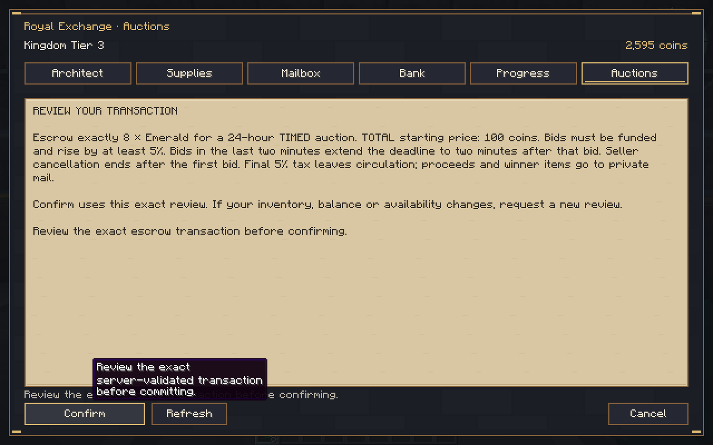
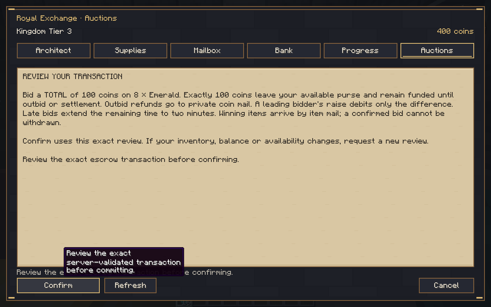
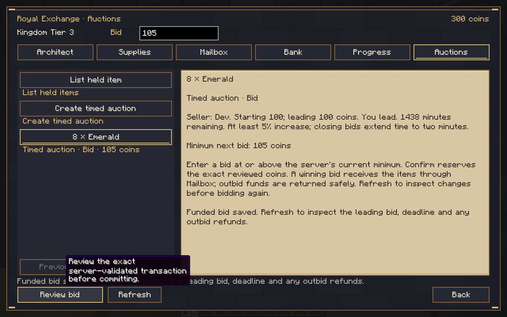
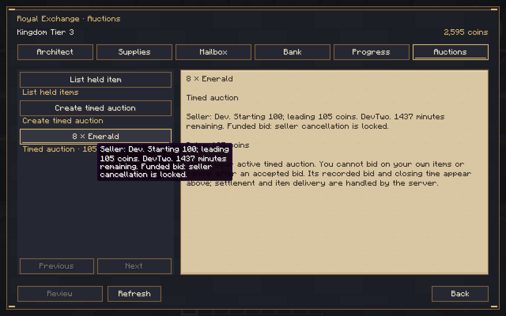
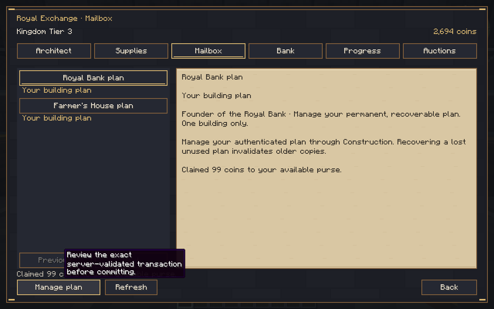
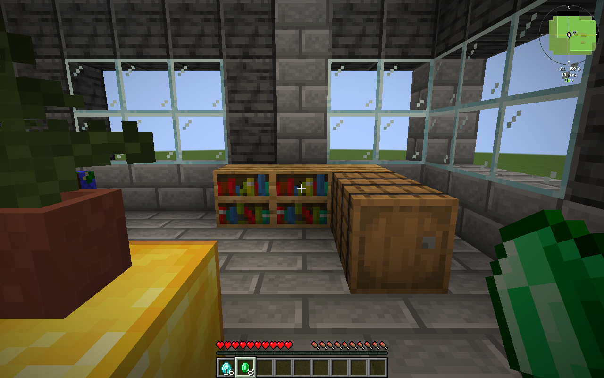
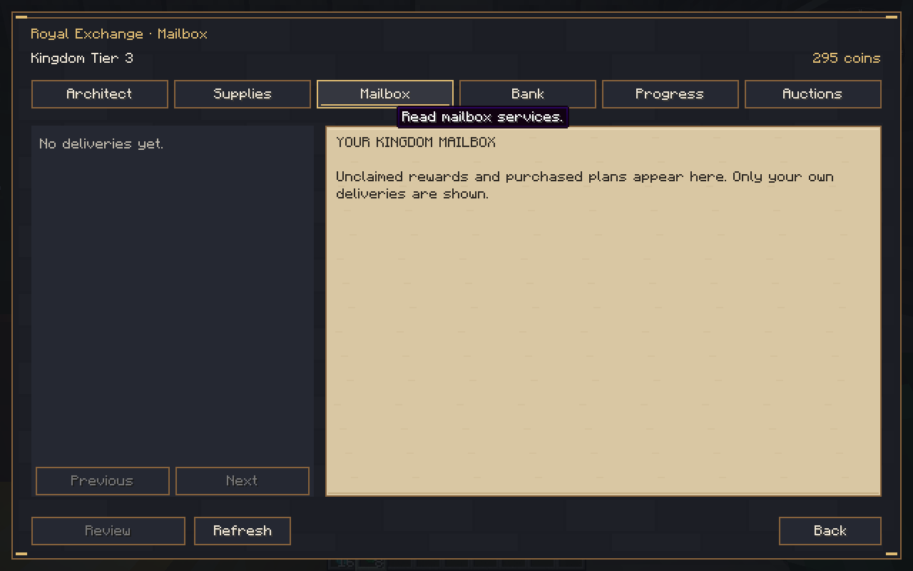
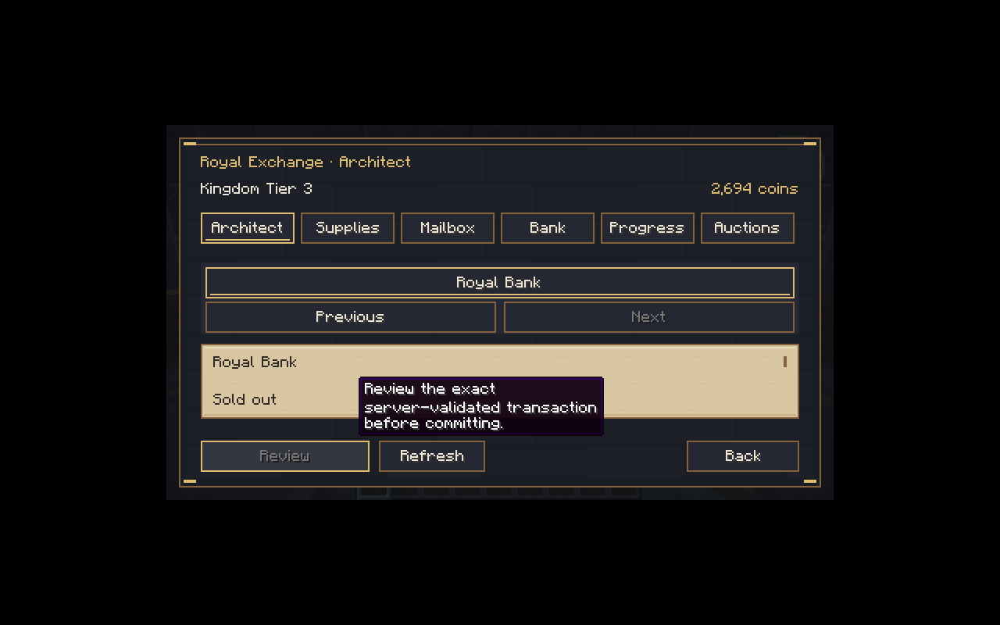

# Royal Gilded 0.9.0-dev — funded timed auctions

Source **af3b428661f08d7cce8e60d79515bccbb3882e97**, branch `rebuild/royal-gilded`. Minecraft **1.21.1**, NeoForge **21.1.265**, **Java21**, protocol **10**. **Development checkpoint, not the finished1.0.0game.** Main was not merged.

[Download the JAR](kingdom-smp-core-0.9.0-dev.jar) · [Screenshots/logs/QA world](test-evidence.zip) · [Checksums](SHA256SUMS.txt) · [Implementation and limits](../../TIMED_AUCTION_CHECKPOINT.md) · [Validation](../../VALIDATION.md) · [Completion matrix](../../PRODUCTION_COMPLETION_MATRIX.md).

SHA-256: `f8fbfeba0ba51046f804b50e46ccea9c5807f3b39b5d2378fbc2990a3be2b13f`.

## Install and use

Back up the entire world and matching player data. Replace Kingdom SMP on both server and client; use one matching version. New escrow journal operations require this version; do not downgrade newer saves without restoring a matching backup. Earlier Hut/Hall, five-minute clickable Hut confirmation, contributions, marketplace, coins, mail and Bank remain.

At Tier3's completed Royal Bank, open **Auctions → Create timed auction**, hold a supported vanilla stack, set quantity and TOTAL starting price, then review/confirm. Timed listings begin at24hours. Another player selects the listing and reviews/confirms a funded bid. First bid may equal the starting price; later bids must increase at least5%, rounded up. Existing leader raises pay only the difference. Outbid funds return through private coin mail. Seller cancellation locks after the first bid. Bids in the last two minutes extend closing to at least two minutes after that bid.

The server settles due auctions automatically without loading chunks or requiring players/NPCs online. Winner items and seller proceeds go to private mail, with no second winner debit. Claim exact items at the actual Bank with adequate inventory space. Ordinary5%/Master10%tax permanently leaves circulation under explicit D-029; Master physical gear remains unimplemented, so live supported vanilla listings use5%.

Operators inspect `/kingdom admin auctions inspect`. An isolated QA copy may explicitly enable `serverconfig/kingdomsmp-sandbox.enabled` and level4 `/kingdom admin auctions settle-test <listing-UUID> confirm <reason>`. It advances only that funded listing to its saved deadline, leaves real time/other listings alone and persists the actor/reason. Missing marker and ordinary players refuse; normal gameplay never creates the marker. Remove it after QA. [Public NPC claims setup](../../PUBLIC_NPC_CLAIM_SETUP.md) remains deliberately opt-in.

## Executed verification

**224JUnit passed**, zero failures/errors/skips; full Gradle build passed. Full normal-dedicated preceding Hut/Hall/Farmer/Tier3/Bank/fixed/timed suite passed with both pinned claim APIs, three registered native peers, actual native inventory, outbid refund, exact settlement, reload, missing-marker/operator restrictions and persisted audit reason. Pure tests verify ceilincrements, rollingextensions, clockrollback/deadlines, contention and before/after-rename interruption recovery.

Two actual graphical clients created8emeralds/starting100. Buyer's400coins became300 on bidding100, then295 on raising to105. Seller cancellation disabled. Full server and both client processes restarted with finalprotocol10; every authority hash remained identical and funded105 survived. The isolated host first observed missing-marker refusal, then explicitly enabled/reviewed the exact sandbox settlement. Winner claimed8emeralds once; seller claimed99, reaching2694; tax6(total11with the previous fixed sale). The16earlier diamonds remained. Marker was removed. **This is explicit deadline acceleration, not24realhours of elapsed gameplay.**

Another normal server restart retained all settled authority hashes. The actual buyer rejoined with8emeralds,16diamonds and295coins, and its claimed item mailbox remained empty. Original history prefix, buildings, entitlements and four NPC identities remained intact. Actual normal and narrow UI was inspected; selected Commerce rows now stay visible after resizing. The old Construction blueprint narrow detail-height limitation remains a separate documented UI follow-up.

## Actual Minecraft captures

Buyorders/partialfills remain absent. Dynamic shops/contracts, all profession gameplay/288quests/signature gear, later buildings/tiers/borders, FTBcampaign and broad mod integrations/administration/full277pack acceptance remain incomplete. Escrow currently accepts bounded vanilla noncontainer stacks only. See the matrix; this checkpoint is not full release acceptance.

The included world belongs to test accounts and is evidence, not a production template. Third-party binaries are not redistributed. Some logs retain diagnosed earlier compile/input failures; only final passing markers count.
